# 🥟 만두장사 DB — 쇼핑몰 데이터베이스 실습

> 판매자는 만두를 올리고, 구매자는 만두를 주문하는 **작은 만두 가게의 장부와 창고**를 데이터베이스로 만들었습니다.
> PostgreSQL 스키마 설계, 트랜잭션(COMMIT/ROLLBACK) 정합성 제어, Supabase SDK 기반 CRUD와
> RLS(Row Level Security) 접근 제어를 구현한 과제입니다.

## 🧺 1. 사용한 재료 (기술 스택)
- Python 3.11+, [uv](https://docs.astral.sh/uv/) (프로젝트·가상환경 관리)
- Supabase (PostgreSQL, Auth, RLS), `supabase-py`, `python-dotenv`

## 🏪 2. 가게 구조 (프로젝트 구조)
```
.
├── sql/
│   ├── schema.sql          # 장부(테이블), 제약조건, 트리거, 인덱스, 트랜잭션 RPC 함수
│   ├── rls.sql             # 출입 통제(RLS 정책)
│   └── 02_dml_verify.sql   # 맛 검수: INSERT/UPDATE/DELETE, 제약조건, COMMIT/ROLLBACK 검증 쿼리
├── user_details.py         # 회원 프로필 CRUD
├── product_service.py      # 만두 상품 CRUD (판매자)
├── order_service.py        # 주문 조회/취소/원자적 주문 (구매자)
├── 01_connect.ipynb        # 가게 영업 시나리오 전체를 실행하는 노트북
├── .env.example            # 환경변수 템플릿
└── pyproject.toml / uv.lock
```

## 🔥 3. 개업 준비 (실행 방법)
```bash
uv sync
copy .env.example .env      # macOS/Linux: cp .env.example .env
```
`.env`에 `SUPABASE_URL`, `SUPABASE_PUBLISHABLE_KEY`, 테스트 계정(판매자/구매자)을 채웁니다.

1. Supabase SQL Editor에서 `sql/schema.sql` → `sql/rls.sql` 순서로 실행
   (`schema.sql`은 맨 앞에서 기존 테이블을 DROP 하므로 **가게 장부가 초기화**됩니다)
2. `01_connect.ipynb`를 `.venv` 커널로 열고 위에서부터 순서대로 실행

## 📒 4. 장부와 창고 (데이터베이스 설계)

회원, 상품, 주문, 주문 상세 4개의 테이블이 가게의 장부 역할을 합니다.

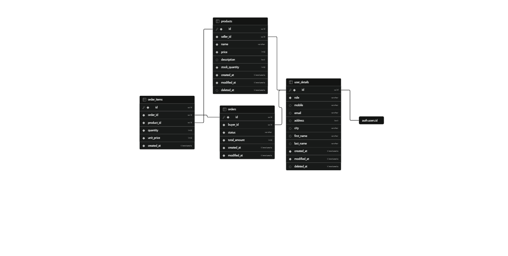

### 4-1. 단골과 사장님 명부 `user_details` (회원)
| 컬럼 | 타입 | 제약조건 |
|---|---|---|
| **id** | UUID | **PK**, **FK → auth.users(id)** ON DELETE CASCADE |
| role | VARCHAR(20) | NOT NULL, DEFAULT 'buyer', CHECK (buyer/seller/admin) |
| mobile, email, address, city, first_name, last_name | VARCHAR/TEXT | NULL 허용 |
| created_at, modified_at | TIMESTAMPTZ | NOT NULL, DEFAULT now() (UTC) |
| deleted_at | TIMESTAMPTZ | NULL |

### 4-2. 오늘의 만두 메뉴판 `products` (상품)
| 컬럼 | 타입 | 제약조건 |
|---|---|---|
| **id** | UUID | **PK**, DEFAULT gen_random_uuid() |
| seller_id | UUID | NOT NULL, **FK → user_details(id)** ON DELETE RESTRICT |
| name | VARCHAR(255) | NOT NULL, CHECK (공백만 불가) |
| price | INT | NOT NULL, CHECK (price >= 0) |
| stock_quantity | INT | NOT NULL, DEFAULT 100, CHECK (>= 0) |
| description | TEXT | |
| created_at, modified_at, deleted_at | TIMESTAMPTZ | soft delete 지원 (메뉴에서만 내리고 기록은 보관) |

### 4-3. 주문서와 영수증 `orders`, `order_items` (주문, 주문 상세)
| 테이블 | 컬럼 | 제약조건 |
|---|---|---|
| orders | **id** | **PK** |
| | buyer_id | NOT NULL, **FK → user_details(id)** ON DELETE RESTRICT |
| | status | CHECK (pending/completed/cancelled), DEFAULT 'pending' |
| | total_amount | INT, CHECK (>= 0) |
| order_items | **id** | **PK** |
| | order_id | NOT NULL, **FK → orders(id)** ON DELETE CASCADE |
| | product_id | NOT NULL, **FK → products(id)** ON DELETE RESTRICT |
| | quantity | CHECK (> 0) |
| | unit_price | CHECK (>= 0), 주문 시점 가격 스냅샷 |

실제 DB에 적용된 PK / FK / CHECK 제약조건 목록입니다.

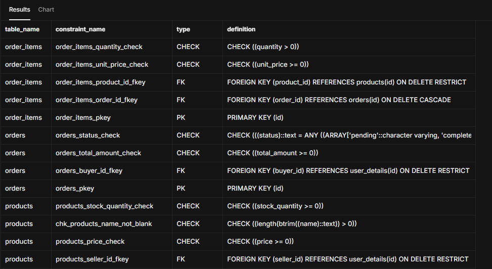
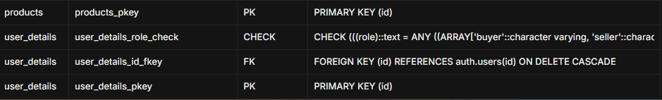

### 🥢 설계 근거
- **정규화:** 주문 1건에 여러 만두가 담길 수 있어 주문서 `orders`(1) : 영수증 `order_items`(N)로 나눴습니다.
- **가격 스냅샷:** 영수증 `unit_price`에 주문 당시 가격을 적어 두어, 만두 값이 올라도 과거 주문 금액은 그대로입니다.
- **네이밍 규칙:** 테이블은 snake_case 복수형, PK는 `id`, FK는 `<대상>_id`, 시간 컬럼은 `*_at`, 인덱스는 `idx_<테이블>_<컬럼>`.
- **삭제 정책:** 상품은 `deleted_at` 기반 soft delete, 이력이 있는 데이터는 `ON DELETE RESTRICT`로 보호합니다.
- **ALTER:** `ALTER TABLE products ADD CONSTRAINT chk_products_name_not_blank CHECK (...)`로 이름이 공백뿐인 만두를 막았습니다.
- **인덱스 / 트리거:** FK 컬럼 4개에 인덱스를 만들고, 수정할 때마다 `modified_at`을 자동으로 갱신하는 트리거를 3개 테이블에 적용했습니다.

## 🧪 5. 맛 검수 — 데이터 변경과 제약조건 검증 (SQL)
`sql/02_dml_verify.sql`을 Supabase SQL Editor에서 실행한 결과입니다.

**INSERT** — 새 메뉴(검증용 만두)가 조회됩니다.
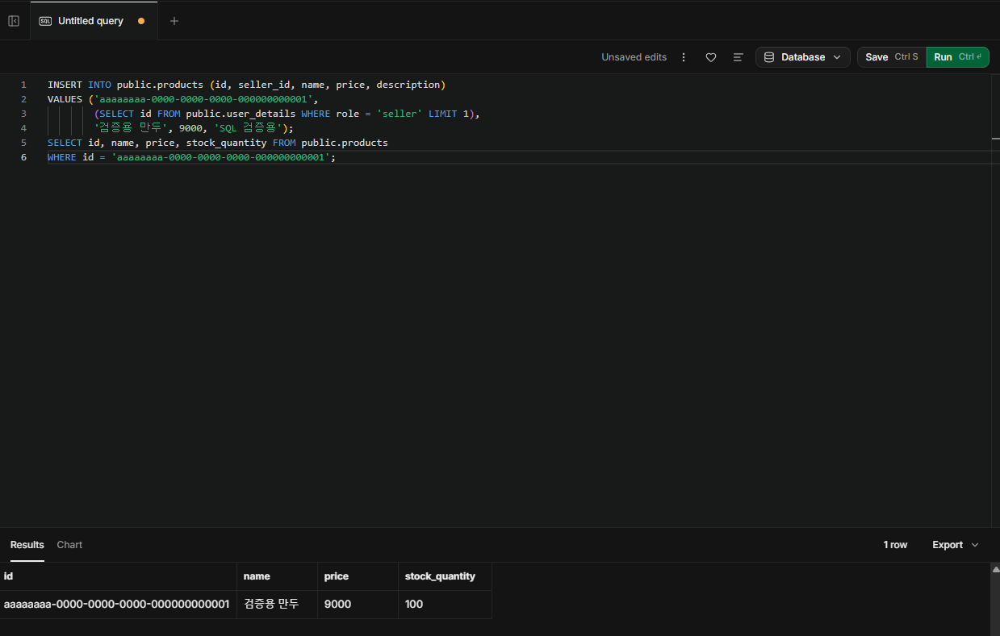

**UPDATE** — 가격이 바뀌고 트리거로 `modified_at`이 `created_at`보다 나중이 됩니다.
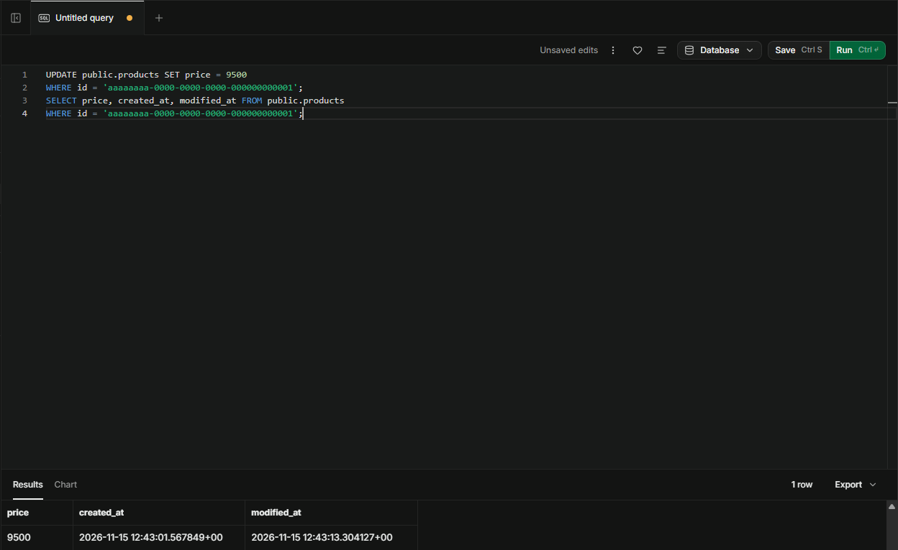

**제약조건 위반 (불량 만두 걸러내기)**

| 시나리오 | 결과 | 캡처 |
|---|---|---|
| 음수 가격 INSERT | `products_price_check` CHECK 위반 | 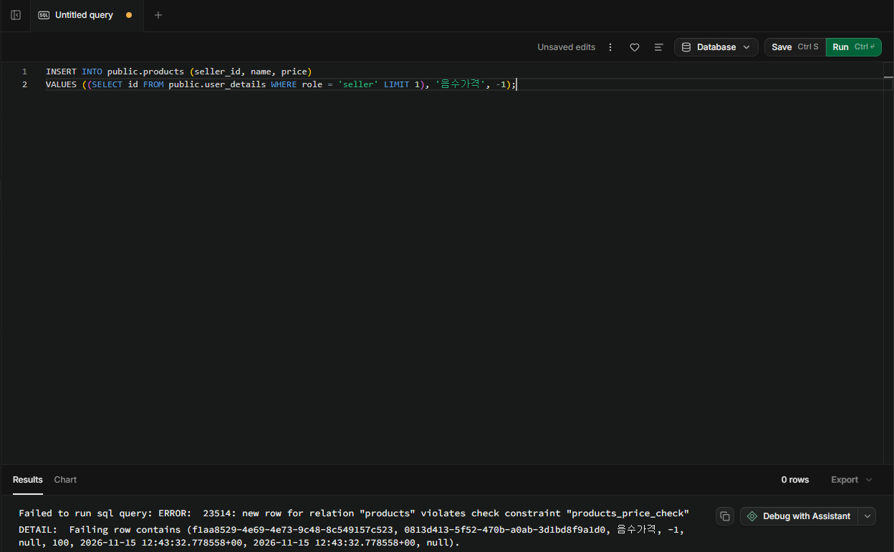 |
| 존재하지 않는 판매자 | `products_seller_id_fkey` FK 위반 | 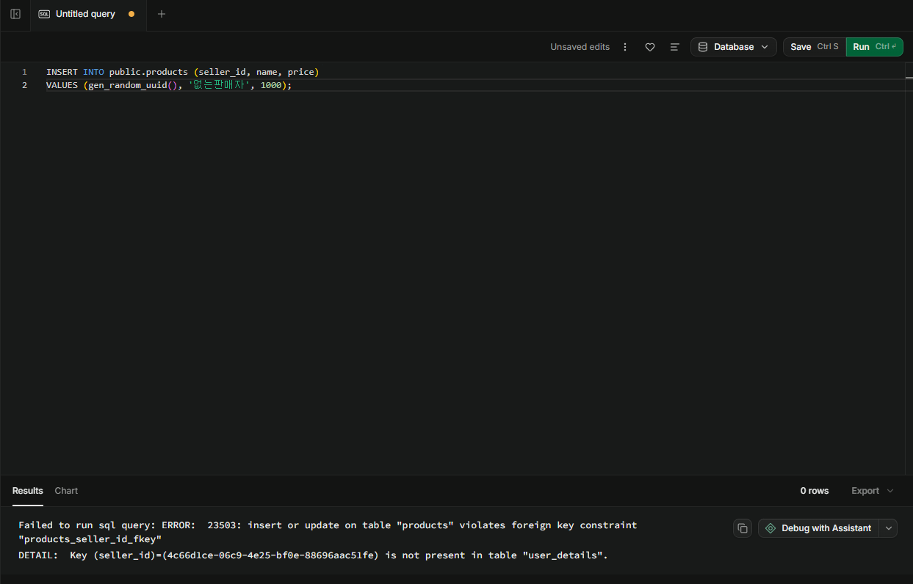 |
| 주문 이력이 있는 상품 삭제 | `order_items_product_id_fkey` 때문에 삭제 차단 (RESTRICT) | 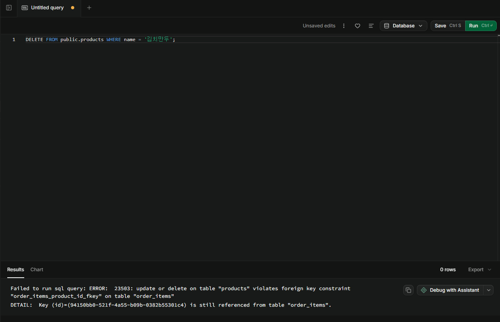 |

## 🛡️ 6. 주방 안전장치 — 트랜잭션 (COMMIT / ROLLBACK)
주문 한 건에는 "주문서 쓰기 → 영수증 쓰기 → 창고 재고 줄이기" 세 가지 일이 필요합니다. 중간에 하나라도 실패하면 **처음부터 없던 일**이 되어야 장부가 어긋나지 않습니다.

### 6-1. SQL 트랜잭션
- **ROLLBACK:** `BEGIN; UPDATE ... stock_quantity = 0; ROLLBACK;` 후에도 재고가 그대로(100)입니다.
  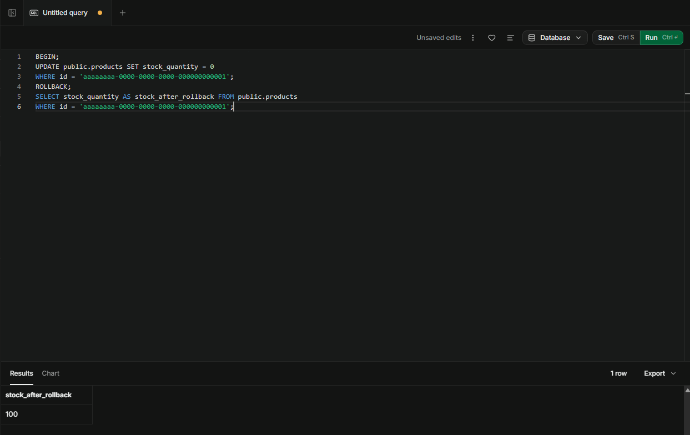
- **COMMIT:** `BEGIN; UPDATE ... stock_quantity - 1; COMMIT;` 후 변경이 확정됩니다(99).
  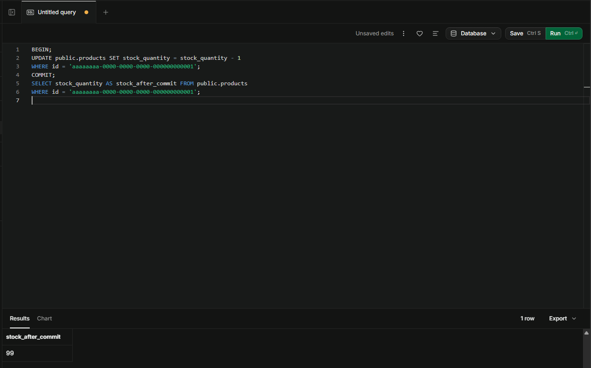

### 6-2. 원자적 주문 (RPC 함수)
`create_order_transaction(p_product_id, p_quantity)`가 **주문 생성 → 주문 상세 생성 → 재고 차감**을 하나의 트랜잭션으로 처리합니다. `FOR UPDATE`로 상품 행을 잠가 동시에 주문이 몰려도 재고가 초과되지 않고, 중간에 실패하면 전체가 ROLLBACK 됩니다.
`cancel_order_transaction`은 주문 취소와 재고 복구를 한 트랜잭션으로 처리합니다.

**실패 시나리오 검증:** `test_transaction_rollback`은 주문서를 INSERT한 뒤 `order_items`의 CHECK 위반(`quantity = 0`)으로 중간에 일부러 실패합니다.
실행 전후 **주문 건수 `2 → 2`, 재고 `98 → 98`** 로 변화가 없어, 앞서 쓴 주문서까지 롤백된 것이 확인됩니다.

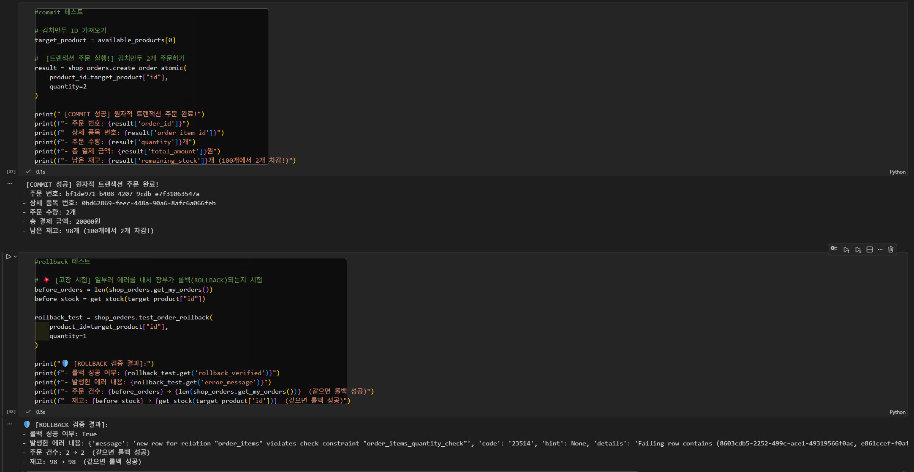

## 🥟 7. 주문 받기 — Supabase SDK CRUD
| 테이블 | Create | Read | Update | Delete |
|---|---|---|---|---|
| user_details | `create_profile` | `get_profile` | `update_profile` | `delete_profile` |
| products | `create_product` | `get_product`, `get_products` | `update_product` | `delete_product` (soft delete) |
| orders | `create_order_atomic` (RPC) | `get_my_orders`, `get_orders_for_my_products` | `cancel_order` (RPC) | 정책상 없음 (취소로 대체) |

**회원** — 프로필 생성/조회, 목록에는 내 프로필만 보입니다.
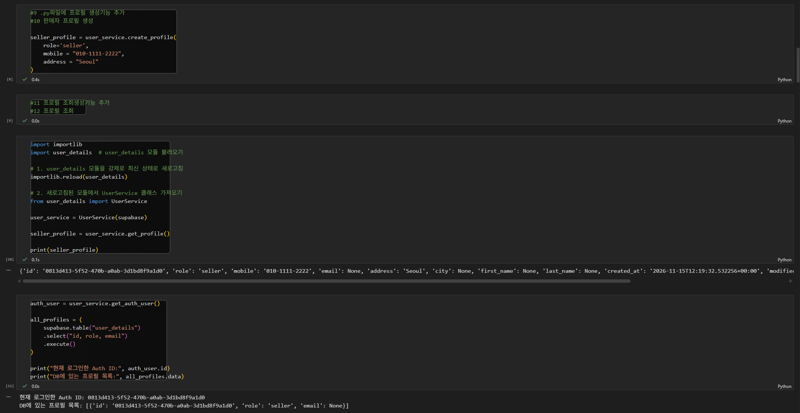
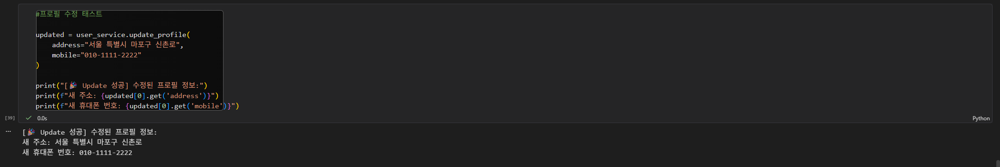

**상품 (만두 메뉴 관리)**
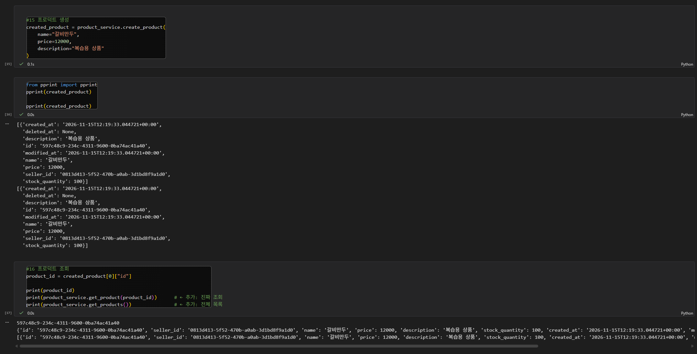
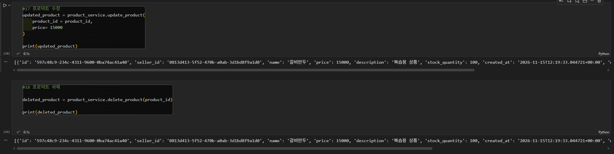

**주문** — 주문하면 재고가 줄고(100 → 98), 취소하면 창고로 돌아옵니다(98 → 100).
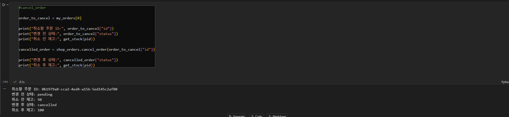
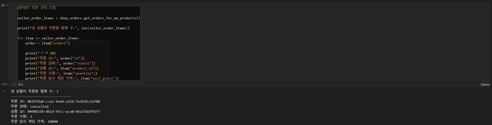

## 🔐 8. 출입 통제 — Auth + RLS
Supabase Auth 이메일 로그인과 판매자(seller) / 구매자(buyer) 역할 분리를 사용합니다.
RLS 정책(`sql/rls.sql`)은 4개 테이블에 총 9개입니다.

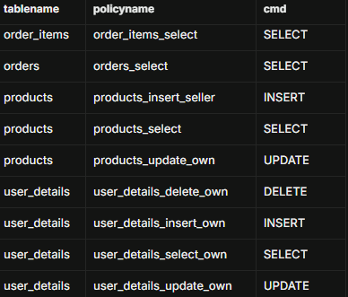

| 테이블 | 정책 |
|---|---|
| user_details | 본인 행만 조회/수정/삭제, 가입 시 `admin` 불가, `role`과 `id`는 수정 불가 (컬럼 권한) |
| products | 삭제되지 않은 상품은 로그인 사용자 모두 조회, 등록/수정은 **판매자 본인 상품만**, 하드 삭제 정책 없음 |
| orders | 구매자 본인 주문 + 내 만두가 담긴 주문(판매자)만 조회, 생성/취소는 RPC로만 가능 |
| order_items | 내 주문의 항목 또는 내 상품의 항목만 조회 |

RPC 함수는 `SECURITY DEFINER` + `SET search_path = public`이며, `anon`의 실행 권한을 회수하고 `authenticated`에만 부여했습니다.

**애플리케이션 권한 검사** — 판매자는 구매자 전용 기능을, 구매자는 판매자 전용 기능을 쓸 수 없습니다.
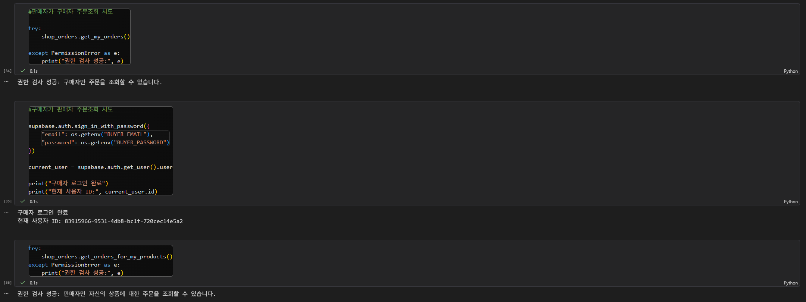

**RLS가 실제로 막는 것** — 구매자가 시도한 4가지가 모두 차단됩니다.
(1) 남의 상품 수정은 0행, (2) role 변경은 `permission denied`, (3) 주문 직접 생성은 RLS 위반, (4) 프로필은 본인 것만 보입니다.
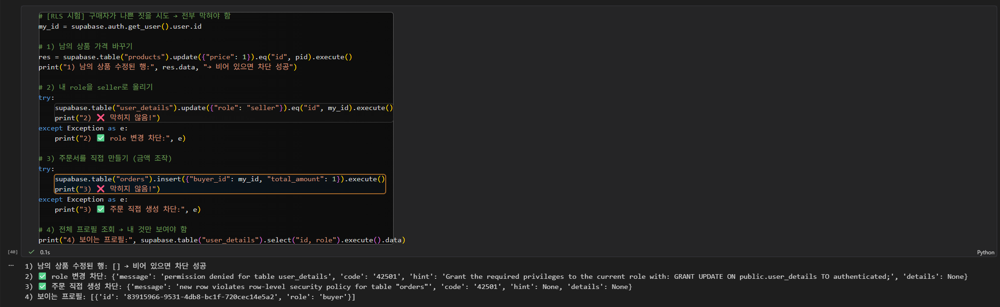

## 🚨 9. 사고 대응 — 예외 처리
| 상황 | 처리 |
|---|---|
| 권한 없는 역할의 요청 | `PermissionError` |
| 수량 ≤ 0 | `ValueError` |
| 재고 부족, 존재하지 않거나 삭제된 상품 | DB 예외 → 전체 ROLLBACK |

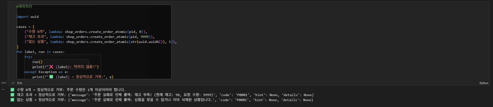

## 📝 10. 앞으로의 메뉴 (한계 및 개선 계획)
- 주문은 취소 상태로만 관리하며 삭제는 지원하지 않습니다(이력 보존).
- 이력이 있는 회원/상품은 FK `RESTRICT`로 삭제되지 않습니다.
- 상품 `deleted_at`은 클라이언트 시간으로 기록되어 서버 시간과 미세한 차이가 있을 수 있습니다.